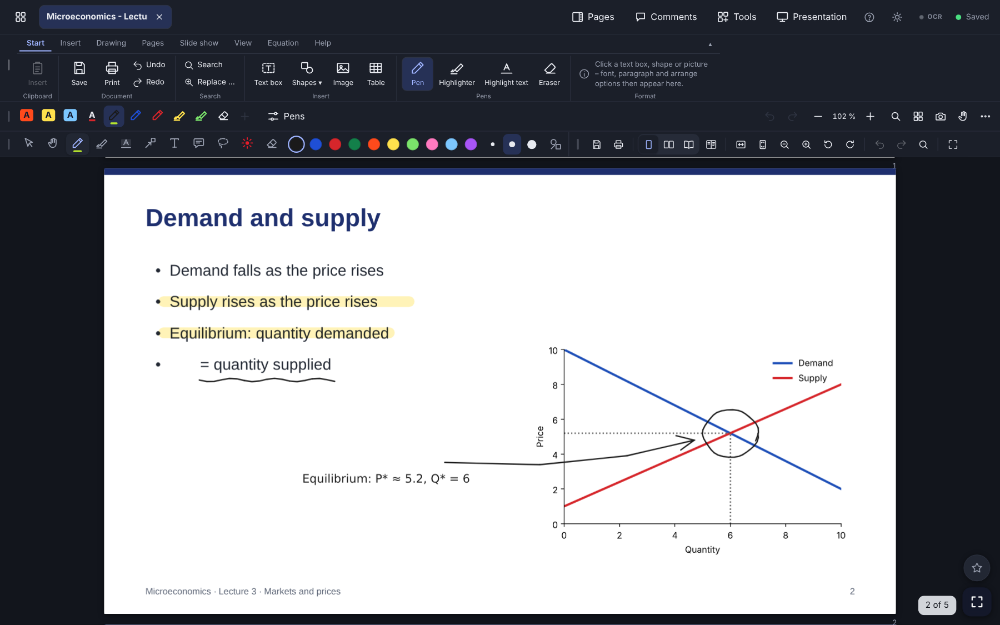
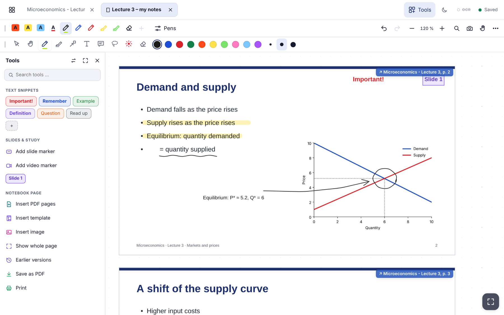
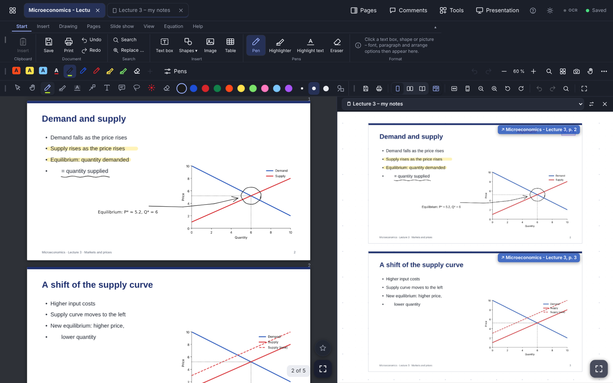
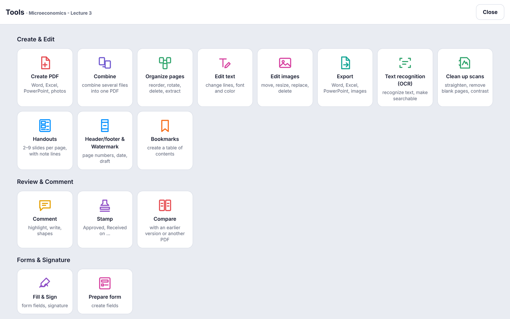

# PDF-Stift

**Annotate PDFs with pen, mouse and keyboard. Free and open source for Windows, Linux and Android.**

PDF-Stift is a PDF app for reading, marking up and organizing documents such as lecture slides, papers and scans. You can write on pages with a stylus, highlight text, add comments and text boxes, and search the full text of your whole library. Notes are saved automatically and written into the PDF, so every other PDF program shows them too.

Everything stays on your device. On Windows and Linux PDF-Stift needs no account, no cloud and no server, and it sends no usage data. Your library is an ordinary folder (`Documents/PDF-Stift`) that you can back up and sync like any other folder. On Android you choose: **offline** (everything stays on the tablet) or **online** with [your own server](docs/SERVER.md) – then the same library is available in every browser and on the tablet.

**[⬇ Download](https://github.com/ek1-wq/pdf-stift/releases/latest)** – Windows (`.exe`), Linux (`.AppImage`, `.deb`), Android (`.apk`), server package (`.zip`) · **[▶ Try the online demo](https://pdf-stift.edu.net.co/)** (password is filled in, reset every hour) · [Deutsch](README.de.md)



## What you can do

- **Write and mark up.** Pen, highlighter, text highlighting, underline and strike-through, shapes, text boxes, sticky-note comments, lasso, eraser and a laser pointer for presenting. Pressure-sensitive pens work on touch screens and pen tablets.
- **Notes become part of the PDF.** They are saved as you write. When you close a PDF, they are written into the file itself, and earlier versions are kept.
- **Full-text search.** Search inside all of your PDFs at once. Scanned pages become searchable through the text recognition built into Windows.
- **Tools.** Organize pages (reorder, rotate, delete, extract, split), combine PDFs, edit text and images, add a header, footer, page numbers or watermark, insert bookmarks, stamp, fill and sign forms, prepare form fields, compare versions, redact, password-protect, export to Word, Excel, PowerPoint or images, and print handouts with 2–9 slides per page.
- **Clean up scans.** Straighten skewed pages, remove blank pages and increase contrast.
- **Fits into Windows.** Open PDFs from Explorer ("Open in PDF-Stift", "Send to"), drag Word, PowerPoint or Excel files in (converted with your installed Microsoft Office), print from any program to the "PDF-Stift" printer, watch a folder, and drag PDFs out into Explorer or an e-mail.
- **Notebook.** Infinite-canvas pages for handwritten notes, organized in notebooks and sections. Copy slides (with your notes) onto a notebook page with one click or by dragging them across, use page templates (Cornell, meeting, lecture), search typed text and copied slides, link notes and PDFs both ways, restore earlier versions, and save or print a page as PDF (split onto A4 sheets).
- **Two documents side by side.** Slides on the left, notebook or a second PDF on the right – with one shared toolbar.
- **Presenting.** Presenter view for a projector or video call: current slide on the big screen, next slide, timer and speaker notes on yours.
- **English and German.** Switch under Settings → Language.







## Install

### Windows

1. Download `PDF-Stift-Setup-….exe` from the [latest release](https://github.com/ek1-wq/pdf-stift/releases/latest).
2. Run it. The installer isn't code-signed yet, so Windows SmartScreen may say "Windows protected your PC". Click **More info → Run anyway**.
3. Start PDF-Stift and add PDFs with **Add PDF**, by dragging them into the window, or by putting them into `Documents\PDF-Stift`.

Updates come automatically: when a new version is out, a blue **Update available** button appears at the top right. Click it, then **Install**. You can also use Help → Check for updates.

Requirements: Windows 10 or 11 (64-bit). Converting Office files needs Microsoft Office. Everything else works without it.

### Linux

Download `PDF-Stift-….AppImage`, make it executable and start it (`chmod +x PDF-Stift-*.AppImage && ./PDF-Stift-*.AppImage`), or install the `.deb` package on Debian/Ubuntu (`sudo apt install ./pdf-stift_…_amd64.deb`). PHP is bundled, nothing else needs to be installed. The AppImage updates itself like the Windows version. Text recognition for scans and Office conversion are Windows-only for now.

### Android

Download `PDF-Stift-….apk` on the tablet and open it (Android asks once to allow installing apps from this source). At the first start choose **Offline** or **Online** with the address of your own server. Updates: a blue **Update** button appears in the app when a new version is out. The Android app is in German for now; text recognition for scans is done on the PC.

### Your own server

Upload the server package to your web space via FTP and use PDF-Stift in any browser and with the Android app – see **[docs/SERVER.md](docs/SERVER.md)** (about 10 minutes, any web host with PHP 8.1).

## How it works

PDF-Stift is an [Electron](https://www.electronjs.org/) app. Its user interface (`app/`, HTML and JavaScript with [PDF.js](https://mozilla.github.io/pdf.js/) and [pdf-lib](https://pdf-lib.js.org/)) talks to a small PHP backend (`app/api.php`). The installer bundles the official PHP build for Windows, and the app starts it as a private server that listens only on `127.0.0.1` and accepts only requests that carry a random key known to the app. No other program and no other computer can reach it.

```
app/          user interface and PHP backend (also the server package)
desktop/      desktop app (Electron) for Windows and Linux: window, menus, printer, Explorer integration, updates
android/      Android app (Kotlin): online with your own server or offline
tools/i18n/   English translation (dictionary + generator)
tools/build-windows.sh   builds the Windows installer (bundles PHP, runs a smoke test)
tools/build-linux.sh     builds AppImage, .deb and the server package (bundles a static PHP, smoke and start test)
```

### Build it yourself

Windows (Git Bash and Node.js 20) and Linux (Node.js 20):

```bash
tools/build-windows.sh 1.0.0      # → desktop/dist/PDF-Stift-Setup-1.0.0.exe
tools/build-linux.sh 1.0.0        # → desktop/dist/PDF-Stift-1.0.0.AppImage, pdf-stift_1.0.0_amd64.deb, pdf-stift-server-1.0.0.zip
```

Android (JDK 17, Gradle 8.9): `cd android && PDFSTIFT_VERSION=1.0.0 gradle assembleRelease` (release signing reads `ANDROID_KEYSTORE_PASSWORD` and `app/release.jks`).

To develop, put a PHP 8.1+ build into `desktop/php/` (`php.exe` plus `php.ini` from `desktop/php.ini`), then run `npm install` and `npx electron .` in `desktop/`.

### Translations

The German texts in the source are the originals. `tools/i18n/en.json` maps each one to English, and `node tools/i18n/i18n.js build` generates the English files (`app/app/app.en.js`, `app/index.en.php`, `desktop/main.en.js`). `node tools/i18n/i18n.js extract` lists the texts that have no translation yet.

## Contributing

Bug reports and ideas are welcome as [issues](https://github.com/ek1-wq/pdf-stift/issues). Please include your system (Windows, Linux distribution or Android version) and the PDF-Stift version (Help → About). Pull requests are welcome too. By contributing you agree that your contribution is licensed under the GPL-3.0.

## License

PDF-Stift is free software: you can redistribute it and/or modify it under the terms of the **GNU General Public License, version 3** ([LICENSE](LICENSE)). It comes with no warranty.

Bundled third-party components (PDF.js, pdf-lib, Tesseract.js, Electron, PHP, PdfiumAndroid, PdfBox-Android and others) keep their own licenses. See [THIRD-PARTY-NOTICES.md](THIRD-PARTY-NOTICES.md).

© PDF-Stift contributors
